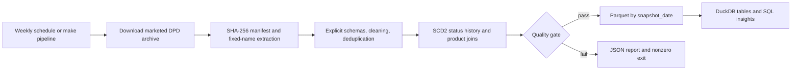

# Canadian drug product ETL

A working PySpark pipeline for Health Canada's **marketed** Drug Product
Database (DPD). It makes drug products, ingredients, companies, therapeutic
classes, and status history queryable in date-partitioned Parquet and DuckDB.
It supports reproducible analysis of the marketed product catalogue and its
historical status events.



## Run locally

Requirements: Python 3.10–3.12, Java 17, curl, [uv](https://docs.astral.sh/uv/), and Make.
On macOS, install Java with `brew install openjdk@17` and set
`JAVA_HOME="$(brew --prefix openjdk@17)/libexec/openjdk.jdk/Contents/Home"`.
With another JDK installation, set `JAVA_HOME` to its home directory.

```sh
make install
export PYSPARK_PYTHON="$PWD/.venv/bin/python"
export SPARK_LOCAL_IP=127.0.0.1
make lint test
make fixture SNAPSHOT_DATE=2026-11-01   # offline 60-product fixture
make pipeline                         # live download, normal quality thresholds
make insights
```

`make extract` downloads and records SHA-256, URL, byte count, and UTC time in
`data/raw/manifest.json`. The digest detects changed downloads; an optional
`--sha256` argument also verifies a known expected digest. An unchanged archive
reuses its extracted files. The current upstream URL can change without notice.
`make transform SNAPSHOT_DATE=2026-11-03` processes already-downloaded files.
`DATA_DIR` changes the output directory. Spark uses two local worker threads,
disables its web UI, and stops its session on success or failure.

## Outputs and quality checks

- `data/parquet/{drug_products,drug_status_history,drug_ingredients}/snapshot_date=YYYY-MM-DD/`
- `data/warehouse/dpd.duckdb`: the same three tables, with `snapshot_date` columns.
- `data/reports/dq_YYYY-MM-DD.json`: every quality result, observed value, and limit.

Rerunning a date replaces that date's rows and partition. Other dates remain.
DuckDB loads all three tables in one transaction; Parquet and DuckDB are separate
storage systems, so a filesystem or database load error can require rerunning
the same date. Run only one writer per data directory.

The gate runs before Parquet or warehouse writes; fixture and live runs pass all 13 checks. Normal thresholds require at
least 10,000 products, zero missing brands/current statuses/product update dates/status event dates,
at most 2% missing DINs, 1% missing companies, 0.1% orphan child rows, 1% removed
product duplicates, and at most a 5% product-count drop versus the latest earlier
snapshot in the warehouse. It also checks unique product keys and valid SCD2
intervals. Violations produce exit code 2. Malformed CSV structure aborts the run.
`--fixture` lowers the minimum to 20 and permits the fixture's deliberate duplicate;
it is never used by the live schedule.

Drug IDs stay numeric and DINs stay strings to preserve leading zeroes. Dates
are parsed explicitly; invalid required dates fail the gate. Text is trimmed,
whitespace is normalized, and names use uppercase. Ingredient strength remains
text because the source allows values that are not simple numbers.

Status history is derived from the events included in each extract, with
half-open `[valid_from, valid_to)` intervals and one open `is_current` version
per product. Exact duplicate events collapse. On a date shared by multiple
statuses, the source's current flag sorts last, then status text provides a
deterministic tie-break. Same-day events can have zero-length intervals because
the source has no time of day. This is an event-derived history within each
snapshot, rather than change detection between weekly downloads. It cannot
reconstruct products missing from the marketed extract. The product table
selects one company and ATC code per drug deterministically; the warehouse is a
summary, not a lossless copy of every source relationship.

## Automation

[CI](.github/workflows/ci.yml) installs Python 3.12 and Java 17, runs lint and
pytest, then runs the actual pipeline on the fixture and uploads its quality
report. The [weekly workflow](.github/workflows/scheduled-etl.yml) downloads live
data every Monday at 11:30 UTC and supports manual dispatch. It caches successful
state for checksum/row-drop comparisons and uploads reports, Parquet, and DuckDB
for 14 days. GitHub cache eviction resets that comparison baseline; cache and
artifacts are demonstration storage, not a durable warehouse. For persistent
history, run `make pipeline` against a retained local `DATA_DIR`.

## Data insights

The figures below are computed from the 2026-11-02 upstream marketed archive,
downloaded 2026-11-03; regenerate them with `make insights` after a live run.
They describe product records, not patients, prescriptions, sales, or treatment
recommendations.

- The snapshot contains **13,379 marketed products**: 11,487 human, 929 veterinary,
  905 disinfectant, and 58 radiopharmaceutical records.
- **2,842 products (21.2%)** report more than one active ingredient, making
  ingredient-level analysis useful alongside product counts.
- Deduplication retains **46,045 distinct status events** for those 13,379 products,
  or 3.44 events per product; a current-only table would discard that history.

SQL queries are in [scripts/insights.py](scripts/insights.py). For example:

```python
import duckdb

with duckdb.connect("data/warehouse/dpd.duckdb", read_only=True) as con:
    print(
        con.execute("""
        SELECT brand_name, din, company_name, active_ingredients
        FROM drug_products
        WHERE snapshot_date = (SELECT max(snapshot_date) FROM drug_products)
          AND atc_group = 'N'
        ORDER BY brand_name, din LIMIT 10
    """).fetchall()
    )
```

## Skills demonstrated

- **PySpark ETL:** enforced source schemas, cleaning, window-based deduplication,
  joins, and SCD2 intervals in [schemas.py](src/dpd_etl/schemas.py) and
  [transform.py](src/dpd_etl/transform.py).
- **Data engineering:** checksum manifests in [extract.py](src/dpd_etl/extract.py),
  quality gates in [quality.py](src/dpd_etl/quality.py), date-partitioned Parquet
  and transactional DuckDB loads in [load.py](src/dpd_etl/load.py).
- **Orchestration and CI:** [Makefile](Makefile), [workflows](.github/workflows/),
  and [fixture integration tests](tests/test_pipeline.py) verify reruns, snapshot
  retention, and rejected bad data.

## Source and scope

[Health Canada DPD extracts](https://www.canada.ca/en/health-canada/services/drugs-health-products/drug-products/drug-product-database/what-data-extract-drug-product-database.html)
provide separate marketed, approved, cancelled, and dormant archives. This
project deliberately downloads only `allfiles.zip` (marketed products).
The fixture's origin and deliberate duplicate are documented in
[tests/fixtures/README.md](tests/fixtures/README.md). Source columns follow
Health Canada's [extract reference](https://www.canada.ca/en/health-canada/services/drugs-health-products/drug-products/drug-product-database/read-file-drug-product-database-data-extract.html).
The source data remains subject to [Health Canada's terms](https://healthycanadians.gc.ca/important-eng.php).
