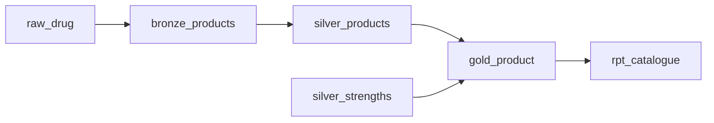

# Catalogue definitions

Generated with `python -m dpd_etl.metrics`.

Grain: one product per snapshot_date and drug_code.

## Metrics

| Metric | Meaning | SQL |
| --- | --- | --- |
| products | Products in the accepted catalogue, counted once per date. | `count(*)` |
| ingredient_records | Distinct ingredient, strength and unit records belonging to those products. | `sum(ingredient_records)` |
| flagged_strengths | Ingredient strength records marked for review, not medical findings. | `sum(flagged_strengths)` |

## Lineage

## Table and column dictionary

### stg_products

Typed product source. DIN means the eight digit Drug Identification Number.

| Column | Meaning | Checks |
| --- | --- | --- |
| din | See table grain. | not_null |
| din_status | See table grain. | accepted_values |

### dim_product

One product on one snapshot date. Product keys include the date.

| Column | Meaning | Checks |
| --- | --- | --- |
| product_key | Snapshot date and Health Canada drug code. | unique, not_null |
| din | Eight digit identification number, kept as text to preserve leading zeros. | not_null |
| company_key | Date and company code, with an explicit UNKNOWN member. | not_null, relationships |

### dim_company

One company code per date; deterministic name when source labels differ.

| Column | Meaning | Checks |
| --- | --- | --- |
| company_key | Snapshot date and company code. | unique, not_null |
| company_name | Source company name, nullable for unknown owners. |  |

### dim_ingredient

One distinct normalized ingredient name across dates.

| Column | Meaning | Checks |
| --- | --- | --- |
| ingredient_key | MD5 of normalized ingredient name, independent of strength. | unique, not_null |
| ingredient | Source ingredient name in upper case. | unique, not_null |

### fct_product

One product per date, with ingredient and review counts aggregated before joins.

| Column | Meaning | Checks |
| --- | --- | --- |
| product_key | See table grain. | unique, not_null, relationships |
| company_key | See table grain. | relationships |
| ingredient_records | Number of distinct ingredient, strength and unit records on this product. |  |
| flagged_strengths | Count of ingredient strength records requiring review, not a medical finding. |  |
| snapshot_date | See table grain. |  |
| drug_class | See table grain. |  |

### fct_product_ingredient

One product, ingredient, strength and unit per snapshot date.

| Column | Meaning | Checks |
| --- | --- | --- |
| product_ingredient_key | See table grain. | unique, not_null |
| product_key | See table grain. | not_null, relationships |
| ingredient_key | See table grain. | not_null, relationships |

### fct_duplicate_pair

One ordered candidate pair per date; is_match distinguishes flagged duplicates.

| Column | Meaning | Checks |
| --- | --- | --- |
| pair_key | See table grain. | unique, not_null |
| left_product_key | See table grain. | relationships |
| right_product_key | See table grain. | relationships |

### rpt_catalogue

Product counts, ingredient records and flagged strengths by date and drug class.

| Column | Meaning | Checks |
| --- | --- | --- |

### time_spine

One calendar date from 2020-01-01 for 10000 consecutive days.

| Column | Meaning | Checks |
| --- | --- | --- |
| date_day | See table grain. | unique, not_null |

